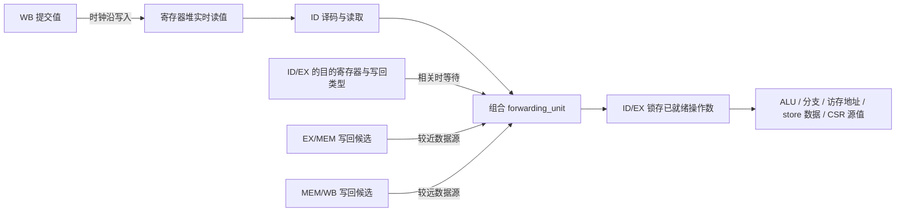

# 当前数据前递逻辑

本核为 IF、ID、EX、MEM、WB 五级顺序流水线，RV32E 与 RV32I 使用相同的前递逻辑。普通 GPR 的 RAW（先写后读）相关在 ID 解决：前递单元位于 `u_id_stage` 与 `u_id_ex_register` 之间，只有源操作数就绪的指令才能进入 ID/EX。EX 直接使用已经锁存的操作数，不再串接前递选择网络。

## 数据通路与实现位置



| 文件 | 职责 |
| --- | --- |
| [`rtl/core/riscv_core_impl.sv`](rtl/core/riscv_core_impl.sv) | 按 ID → 前递 → ID/EX → EX 连接，监视三个寄存后的生产者边界 |
| [`rtl/core/pipeline/id_stage.sv`](rtl/core/pipeline/id_stage.sv) | 译码源寄存器及使用标志，等待期间持续读取 GPR |
| [`rtl/core/units/forwarding_unit.sv`](rtl/core/units/forwarding_unit.sv) | 检测 EX 相关，选择 EX/MEM、MEM/WB 或 GPR 值，未就绪时反压 ID |
| [`rtl/core/pipeline/ex_stage.sv`](rtl/core/pipeline/ex_stage.sv) | 使用 ID/EX 锁存的操作数执行，生成 EX/MEM 事务 |
| [`rtl/core/pipeline/mem_stage.sv`](rtl/core/pipeline/mem_stage.sv) | 完成 load 数据整理，生成进入 MEM/WB 的事务 |
| [`rtl/core/units/regfile.sv`](rtl/core/units/regfile.sv) | GPR 阵列组合读与 WB 同步写；同拍写回值由前递单元选择 |
| [`rtl/core/pipeline/pipeline_ctrl.sv`](rtl/core/pipeline/pipeline_ctrl.sv) | CSR、SYSTEM、FENCE.I、异常的串行化与改道控制 |

前递单元以 `id_ex_if.consumer decoded` 消费 ID 的组合输出，以 monitor 接口观察 ID/EX、EX/MEM 和 MEM/WB。输出仍为完整的 `id_ex_if` 事务，只改写 `exec_data.rs1_value`、`exec_data.rs2_value`，其他字段透传。模块没有时钟、复位和内部寄存状态，不增加流水级。

## 生产者与选择优先级

写回候选使用 `writeback_payload_t`，将“存在生产者”的 `valid` 与“数据已就绪”的 `data_valid` 分开表示。每路源独立解析，只有 `rs*_used=1` 且源地址不为 x0 时才匹配。

1. **ID/EX 匹配：等待。** 候选来自寄存后的 `valid`、`ctrl.wb_sel`、`reg_addr.rd_addr` 和异常状态。有效、无已知异常、`wb_sel != WB_NONE` 且目的不为 x0 的指令构成生产者。这里不读取 EX 组合结果，也不依赖 `ex_result.valid` 或 EX 能否推进；即使 EX 受阻也不能漏掉相关。
2. **EX/MEM 匹配：** `wb_req.data_valid=1` 时选择其值，否则等待。
3. **MEM/WB 匹配：** `wb_req.data_valid=1` 时选择其值，否则等待。
4. **均不匹配：** 使用 ID 当前的 GPR 读值。

EX/MEM 和 MEM/WB 的候选有效位同时受流水事务 valid 与 `wb_req.valid` 门控。最近生产者匹配但未就绪时，不能使用较老生产者或 GPR 的值。例如：

```asm
addi x5, x0, 1
lw   x5, 0(x6)
add  x7, x5, x8
```

当 `lw` 位于 ID/EX 或 EX/MEM、`addi` 位于更老边界时，`add` 必须等待 `lw`，不能使用 `addi` 的 1。

未使用源字段和 x0 不产生冒险。EX 提前清除目的为 x0 或带异常指令的写回请求；MEM 在访存错误时清除写回请求，最终由 WB 提交异常并冲刷年轻指令。

## 握手与停顿

```text
source_stall = rs1_result.stall || rs2_result.stall
result.valid = decoded.valid && !source_stall
decoded.ready = result.ready && !source_stall
```

顶层连接 `id_result` → 前递 → `forward_result` → ID/EX → `id_result_buffered` → EX。前递输入与输出的 fire 相等，表示当前指令被 ID/EX 接收，不再表示指令执行完成。ID 的 `ready` 将相关等待传播到 IF/ID；较老的 EX、MEM、WB 可独立推进。

ID/EX 非组合穿透，允许满载时同拍弹出和写入。无相关且下游就绪时，可以每拍接收一条指令；遇到 ID/EX 的相关生产者，即使生产者本拍离开，也要等下一拍才能使用 EX/MEM 的寄存结果。

假设连续供给且没有额外容量、取指或总线等待，相邻 ALU 依赖时：

| 周期 | 生产者 `addi x5,x0,1` | 消费者 `add x6,x5,x7` | 行为 |
| --- | --- | --- | --- |
| T | ID/EX，在 EX 计算 | ID 等待 | 匹配 ID/EX，禁止消费者进入；生产者继续推进 |
| T+1 | EX/MEM | ID | 前递结果，本拍末进入 ID/EX |
| T+2 | MEM/WB | ID/EX，在 EX 计算 | 使用上一拍锁存的操作数 |

相比 EX 入口前递，相邻 ALU 依赖增加一拍气泡。数据路径不引入 EX→ID 的组合结果旁路，EX/MEM 到前递选择、前递选择到 ALU 之间由 ID/EX 隔开；实际时序收益需通过综合和 STA 测量，并结合 CPI 评估。

load 的 EX/MEM 候选始终标记为数据未就绪。即使本拍总线响应有效，也不从 MEM 组合输出或总线响应直接前递：

| 周期 | load 状态 | 依赖指令的行为 |
| --- | --- | --- |
| T | ID/EX，在 EX 生成地址 | ID 匹配 EX 生产者，等待 |
| T+1 起 | EX/MEM，发出请求并等待响应 | ID 匹配未就绪生产者，继续等待 |
| R | 响应握手，本拍末进入 MEM/WB | 本拍仍等待 EX/MEM 的未就绪候选 |
| R+1 | MEM/WB 中有对齐并扩展的 load 值 | 前递并在本拍末进入 ID/EX |
| R+2 | load 已提交或离开 | 消费者在 EX 使用锁存值 |

load-use 等待长度取决于实际访存时序，不能统一称为固定一拍。

## 等待期间的 GPR 值与冲刷

ID 在等待另一路源或下游容量时，寄存器堆仍持续组合读取。如果某路 MEM/WB 先写回并离开，同拍由前递单元的 MEM/WB 候选提供数据，下一拍由 GPR 阵列提供已提交值。因此不需要保留之前在 EX 前递中使用的两路 MEM/WB 暂存值。寄存器堆本身不再重复做同拍写回旁路，所有在途生产者的优先级与数据选择统一由前递单元处理。

指令被 ID/EX 接收后，操作数随完整事务一起保存。EX 反压期间这些值保持稳定，不随 GPR 或候选变化。

EX 分支改道通过 IF/ID 的 `FlushMask=1` 当拍屏蔽错误路径，清除前端等待指令；WB 改道同时刷新后端。前递模块无内部状态，不需要额外的取消或复位逻辑。CSR/SYSTEM 与异常仍由 `pipeline_ctrl` 串行化，执行前等待更老事务排空。

ALU、分支比较、JALR/load/store 的基址、store 的 rs2 数据和寄存器形式 CSR 源值均使用 ID/EX 的已就绪操作数。MEM 不增加额外的 store 数据旁路。CSR 寄存器之间仍无专用前递网络。

数据相关停顿归入 ID。ID 的调试入口握手自然包含前递反压；EX 的调试事件由 EX 直接输出，不再在顶层补入前递等待。

## 验证入口

```sh
make check RVE=1
make check RVE=0
make test-forwarding RVE=1
make test-forwarding RVE=0
```

`forwarding_tb` 检查生产者优先级、EX 相关阻塞、未使用源、x0 和握手。`forwarding_pipeline_tb` 使用真实 GPR 和 ID/EX，检查相邻依赖的排空、等待 load 时另一源的独立写回、操作数锁存与反压稳定性、同拍替换和冲刷。

系统差分验证应通过工作台 Makefile 运行 mini-soc 对 NEMU 的 dummy、相关 cpu-tests 和 RT-Thread；命令与环境要求见工作台 `AGENTS.md`。局部检查不能替代系统验证，功能测试也不能替代时序测量。
