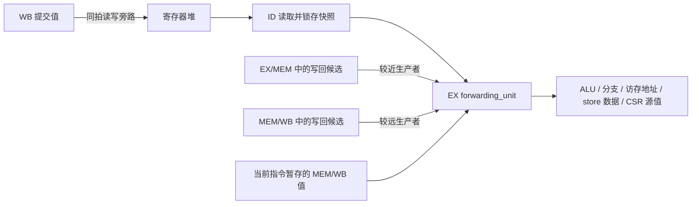

# 当前数据前递逻辑

本核为 IF、ID、EX、MEM、WB 五级顺序流水线，RV32E 与 RV32I 使用相同的前递逻辑。普通 GPR 的 RAW（先写后读）相关在 EX 解决：ID 可以先锁存寄存器堆的读值，EX 再用较老指令产生的新值覆盖它，不必等生产者写回后才译码。

原有临时 ID RAW 屏障及其开关、监视接口和握手门控已移除。ID 的输入使能现在是 `!serialize_block_i && !flush_i`；能否接收还取决于 ID/EX 弹性寄存器容量。CSR、异常等串行化要求仍由 `pipeline_ctrl` 控制。

## 数据通路与实现位置



| 文件 | 职责 |
| --- | --- |
| [`rtl/core/pipeline/id_stage.sv`](rtl/core/pipeline/id_stage.sv) | 译码源寄存器及使用标志，锁存 GPR 读值到 ID/EX |
| [`rtl/core/units/forwarding_unit.sv`](rtl/core/units/forwarding_unit.sv) | 分别解析 rs1、rs2，选择前递值、产生停顿、保存短暂出现的 WB 值 |
| [`rtl/core/pipeline/ex_stage.sv`](rtl/core/pipeline/ex_stage.sv) | 从 EX/MEM 构造 `ex_wb`，使用前递结果，控制 ID/EX 向 EX/MEM 转移 |
| [`rtl/core/pipeline/mem_stage.sv`](rtl/core/pipeline/mem_stage.sv) | 完成 load 数据整理，从 MEM/WB 构造 `mem_wb_forward` |
| [`rtl/core/units/regfile.sv`](rtl/core/units/regfile.sv) | GPR 组合读、WB 同步写，以及 WB 到 ID 的同拍读写旁路 |
| [`rtl/core/pipeline/pipeline_ctrl.sv`](rtl/core/pipeline/pipeline_ctrl.sv) | CSR、SYSTEM、FENCE.I、异常的串行化与改道控制 |

`forwarding_unit` 的端口 `ex_wb` 实际来自 **EX/MEM 寄存器输出**，`mem_wb` 来自 **MEM/WB 寄存器输出**。它们都不是当前流水级尚未锁存的组合计算结果。

## 写回候选与选择优先级

前递接口使用 `writeback_payload_t`：

| 字段 | 含义 |
| --- | --- |
| `valid` | 存在有效的 GPR 写入生产者；由流水事务有效位与 `wb_req.valid` 共同门控 |
| `rd_addr` | 目的寄存器地址 |
| `data_valid` | 结果已经可用；与“存在生产者”分开表示 |
| `wdata` | 可用的写回数据 |

对 rs1、rs2 **独立**选择，只有 `rs*_used=1` 且源地址不为 x0 时才参与匹配。优先级如下：

1. EX/MEM 有匹配的有效生产者：`data_valid=1` 时使用其值，否则停顿。
2. EX/MEM 不匹配，MEM/WB 有匹配的有效生产者：数据就绪时使用其值，否则停顿。
3. 两处均不匹配：使用当前指令先前保存的 MEM/WB 值；没有保存值时使用 ID/EX 的 GPR 快照。

较近生产者优先于较远生产者，也优先于已保存值。**较近生产者匹配但数据未就绪时，不能退回较老的值。** 例如：

```asm
addi x5, x0, 1
lw   x5, 0(x6)
add  x7, x5, x8
```

当 `lw` 位于 EX/MEM、`addi` 位于 MEM/WB 时，`add` 必须等待 `lw`，不能使用 `addi` 的 1。

未使用的源字段不产生冒险。x0 不参与前递匹配，寄存器堆保证其读值为零；EX 也提前清除目的为 x0 或带异常指令的 `wb_req.valid`。发生访存错误时，MEM 清除写回请求，随后由 WB 提交异常并冲刷年轻指令。

## 哪些数据能够前递

| 结果类型 | EX/MEM 中的状态 | 消费方式 |
| --- | --- | --- |
| ALU、LUI、AUIPC 的结果 | 数据就绪 | 可直接前递到 EX |
| JAL、JALR 的 PC+4 | 数据就绪 | 可直接前递到 EX；实际相遇时序取决于取指与改道 |
| load 的结果 | 有生产者，数据未就绪 | 等待数据响应经过 MEM/WB 后再前递 |
| CSR 指令写入 GPR 的旧 CSR 值 | 数据就绪 | 使用普通 GPR 写回路径；CSR 指令本身仍受串行化约束 |

EX 的前递值同时供给 ALU 寄存器操作数、分支比较、JALR/load/store 的基址、store 的 rs2 数据，以及寄存器形式 CSR 指令的源值。store 数据在 EX 选好并锁入 EX/MEM，MEM 再执行字节通道对齐，没有额外的 WB 到 MEM store 数据旁路。

CSR 寄存器之间没有专用前递网络。CSR/SYSTEM 等指令在 EX 执行前等待更老事务排空，并阻止年轻指令进入 ID/EX，以保证 CSR 读取和提交顺序。

## 停顿与典型时序

`forward_stall` 为两路源操作数停顿请求的或。EX 的握手条件为：

```text
input_enable = !forward_stall && !serialize_stall && !flush_i
id_ex.ready  = ex_mem_input_ready && input_enable
execute_fire = id_ex.valid && id_ex.ready
```

前递未就绪时不把当前指令写入 EX/MEM；较老的 MEM、WB 仍可继续排空。即使操作数已就绪，EX/MEM 容量不足也会通过 ready/valid 产生反压。流水寄存器允许满载时同拍读写，所以连续 ALU 依赖不必插入数据相关气泡。

以下示例假设指令已连续进入流水线，且没有额外取指、总线、容量或串行化停顿。每行表示一个时钟沿之后的周期状态：

| 周期 | 生产者 `addi x5,x0,1` | 消费者 `add x6,x5,x7` | 行为 |
| --- | --- | --- | --- |
| T | ID/EX，在 EX 计算 | ID | ID 可锁存尚未更新的 x5 快照 |
| T+1 | EX/MEM | ID/EX，在 EX 计算 | 从 EX/MEM 取得 x5=1，本拍末可进入 EX/MEM |
| T+2 | MEM/WB | EX/MEM | 生产者提交，消费者继续推进 |

load-use 时，load 在 EX/MEM 中的 `data_valid` 始终为 0。即使本拍总线响应已有效，也不从响应组合路径直接前递：

| 周期 | load 状态 | 依赖指令的行为 |
| --- | --- | --- |
| T | 在 EX 生成地址，尚未得到数据 | 位于 ID |
| T+1 起 | EX/MEM 保留 load 元数据，等待请求/响应完成 | 在 EX 等待，`forward_stall=1` |
| R | 响应握手，本拍末 load 进入 MEM/WB | 本拍仍匹配 EX/MEM 的未就绪生产者，继续等待 |
| R+1 | MEM/WB 中已有对齐并按需扩展的 load 值 | 从 MEM/WB 前递；其他条件允许时，本拍末执行推进 |

因此 load-use 的等待长度取决于实际访存时序，不能统一称为固定一拍停顿。

## 反压期间为什么要保存 MEM/WB 值

ID/EX 保存的是译码时的快照。当前指令可能因另一个源寄存器等待 load，或因下游反压而无法执行；此时 MEM/WB 中的较老指令仍会写回并离开。若只做组合选择，下一拍可能退回过期快照。

`forwarding_unit` 为 rs1、rs2 各保存一份值和 valid：

- 当前事务有效但尚未 `execute_fire`，且某路实际选中了 MEM/WB 值时，保存该值。
- MEM/WB 离开后，保存值替代 ID/EX 快照；仍可被当前有效候选覆盖。
- 复位、当前事务无效或 `execute_fire` 时清除保存有效位。即使 ID/EX 同拍替换成下一条指令，保存值也不会串到下一条。
- 后端 flush 清除 ID/EX 的 valid，前递保存状态随后在观察到事务无效的时钟沿清除。普通 EX 分支只刷新前端，不取消正在执行的事务。

这里只需要保存 MEM/WB 数据：EX/MEM 在受阻时保持生产者，离开后其结果还会在 MEM/WB 出现。数据位本身不复位，只有 valid 控制是否使用。

## 验证入口

从本仓库根目录执行：

```sh
make check RVE=1
make check RVE=0
```

系统差分验证应通过工作台 Makefile 运行 mini-soc 对 NEMU 的 dummy、相关 cpu-tests 和 RT-Thread；命令与环境要求见工作台 `AGENTS.md`。综合语义检查不能替代系统验证。
